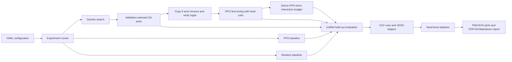

# System architecture

`config.py` validates dimensions and seed separation. `environment.py` owns Gymnasium
construction and terminal classification. `policy.py` owns the 4,996-scalar representation.
`genetic_algorithm.py` has independent initialization, parent-selection, crossover and mutation
RNGs. `weight_transfer.py` maps actor layers and verifies unchanged critic tensors.
`ppo_agent.py` instruments SB3 **after** each optimizer update, so validation is correctly
attributed to the updated model. `experiment.py` tracks allocations and selected checkpoint paths.

Every completed suite records resolved settings and machine/package provenance. Agent directories
are identified by method and training seed. All analyses require an explicit suite path.
